# Reference-based bias detection: replication report

Replication of *Reference-Based Bias Detection in LLMs via Relative Representations of Hidden States* (arXiv:2609.10060v1) on Kaggle 2× T4. Generated by `python -m rbbd.cli report` from the aggregates in `results/` (D-102); every number below comes from the CSVs in `results/report/` and `results/m6/`.

## Verdict (pre-registered, PLAN §1.2)

- **Tier 1: refuted.** C1 0/9 settings, C2 0/8, C3 1/6 (model, benchmark) pairs. Significant positive r (n ≥ 50): gemma3-4b-it/qlora-s0 wgm; gemma3-4b-it/qlora-s0 dt; gemma3-4b-it/qlora-s0 toxigen; llama3.1-8b-it/qlora-s0 wgm; llama3.1-8b-it/qlora-s0 dt.
- **Tier 2: refuted.** C1 6/12 settings, C2 6/11, C3 5/8 (model, benchmark) pairs. Significant positive r (n ≥ 50): llama3.2-1b-it/full-s0 wgm; llama3.2-1b-it/full-s0 dt; llama3.2-1b-it/full-s0 toxigen; llama3.2-1b-it/lora-s0 wgm; llama3.2-1b-it/lora-s0 toxigen.
- Settings meeting both C1 and C2: qwen2.5-0.5b-it/full-s0, qwen2.5-0.5b-it/lora-s0 (6/21 setting × benchmark cells). The paper reports C1 in 15/18 of its settings.
- C1: r(Δscore, ΔB) < 0 with p < 0.05. C2: AUC 95% CI lower bound > 0.5. C3: AUC_RR − AUC_SEAT paired CI > 0 (WGM, DT). Refuted if C1 holds in ≤ 1/3 of a tier's settings or any setting has a significant positive r; WGM p-values treat groups as independent although groups of a topic share a score (its CIs resample (checkpoint, topic) clusters).

| Tier | Settings | C1 | C2 | C3 | Significant positive r (n ≥ 50) | Verdict |
|---|---|---|---|---|---|---|
| 1 | 9 | 0/9 | 0/8 | 1/6 | gemma3-4b-it/qlora-s0 wgm; gemma3-4b-it/qlora-s0 dt; gemma3-4b-it/qlora-s0 toxigen; llama3.1-8b-it/qlora-s0 wgm; llama3.1-8b-it/qlora-s0 dt | refuted |
| 2 | 12 | 6/12 | 6/11 | 5/8 | llama3.2-1b-it/full-s0 wgm; llama3.2-1b-it/full-s0 dt; llama3.2-1b-it/full-s0 toxigen; llama3.2-1b-it/lora-s0 wgm; llama3.2-1b-it/lora-s0 toxigen | refuted |

### Per setting

| Tier | Setting | Benchmark | r (p) | AUC (CI low) | C1 | C2 | C3 |
|---|---|---|---|---|---|---|---|
| 1 | gemma3-4b-it/qlora-s0 | WildGuardMix | 0.45 (0.000) | 0.26 (0.16) | ✗ | ✗ | ✗ |
| 1 | gemma3-4b-it/qlora-s0 | DecodingTrust | 0.29 (0.000) | n/a | ✗ | n/a | ✗ |
| 1 | gemma3-4b-it/qlora-s0 | ToxiGen | 0.29 (0.021) | 0.34 (0.21) | ✗ | ✗ | – |
| 1 | llama3.1-8b-it/qlora-s0 | WildGuardMix | 0.20 (0.009) | 0.34 (0.19) | ✗ | ✗ | ✗ |
| 1 | llama3.1-8b-it/qlora-s0 | DecodingTrust | 0.23 (0.003) | 0.42 (0.29) | ✗ | ✗ | ✓ |
| 1 | llama3.1-8b-it/qlora-s0 | ToxiGen | 0.25 (0.052) | 0.34 (0.18) | ✗ | ✗ | – |
| 1 | mistral-7b-it/qlora-s0 | WildGuardMix | 0.12 (0.115) | 0.55 (0.48) | ✗ | ✗ | ✗ |
| 1 | mistral-7b-it/qlora-s0 | DecodingTrust | 0.14 (0.063) | 0.47 (0.37) | ✗ | ✗ | ✗ |
| 1 | mistral-7b-it/qlora-s0 | ToxiGen | -0.06 (0.636) | 0.63 (0.50) | ✗ | ✗ | – |
| 2 | llama3.2-1b-it/full-s0 | WildGuardMix | 0.16 (0.040) | 0.48 (0.34) | ✗ | ✗ | ✗ |
| 2 | llama3.2-1b-it/full-s0 | DecodingTrust | 0.31 (0.000) | n/a | ✗ | n/a | ✗ |
| 2 | llama3.2-1b-it/full-s0 | ToxiGen | 0.36 (0.004) | 0.28 (0.17) | ✗ | ✗ | – |
| 2 | llama3.2-1b-it/lora-s0 | WildGuardMix | 0.44 (0.000) | 0.30 (0.15) | ✗ | ✗ | ✓ |
| 2 | llama3.2-1b-it/lora-s0 | DecodingTrust | 0.10 (0.176) | 0.31 (0.18) | ✗ | ✗ | ✗ |
| 2 | llama3.2-1b-it/lora-s0 | ToxiGen | 0.62 (0.000) | 0.21 (0.08) | ✗ | ✗ | – |
| 2 | qwen2.5-0.5b-it/full-s0 | WildGuardMix | -0.64 (0.000) | 0.89 (0.84) | ✓ | ✓ | ✓ |
| 2 | qwen2.5-0.5b-it/full-s0 | DecodingTrust | -0.67 (0.000) | 0.90 (0.82) | ✓ | ✓ | ✓ |
| 2 | qwen2.5-0.5b-it/full-s0 | ToxiGen | -0.73 (0.000) | 0.88 (0.79) | ✓ | ✓ | – |
| 2 | qwen2.5-0.5b-it/lora-s0 | WildGuardMix | -0.77 (0.000) | 0.94 (0.86) | ✓ | ✓ | ✓ |
| 2 | qwen2.5-0.5b-it/lora-s0 | DecodingTrust | -0.81 (0.000) | 0.91 (0.86) | ✓ | ✓ | ✓ |
| 2 | qwen2.5-0.5b-it/lora-s0 | ToxiGen | -0.86 (0.000) | 0.99 (0.98) | ✓ | ✓ | – |

### Secondary claims (S1-S7)

Outcome by thirds of the testable settings: ≥ 2/3 holds, ≤ 1/3 fails, else mixed (D-102).

| Claim | Holds | Outcome | Detail |
|---|---|---|---|
| S1: \|r\| larger under full FT than LoRA (same model) | 1/6 | fails | llama3.2-1b-it wgm: 0.16 vs 0.44; llama3.2-1b-it dt: 0.31 vs 0.10; llama3.2-1b-it toxigen: 0.36 vs 0.62; qwen2.5-0.5b-it wgm: -0.64 vs -0.77; qwen2.5-0.5b-it dt: -0.67 vs -0.81; qwen2.5-0.5b-it toxigen: -0.73 vs -0.86 |
| S2: Procrustes-SEAT near chance (AUC CI contains 0.5) | 14/19 | holds |  |
| S3: CKA drift detects but stays below RR | 3/19 | fails | CKA CI above 0.5 in 11/19; CKA below RR in 6/19 |
| S4: Mean pooling is best (RR) | 6/14 | mixed |  |
| S5: AUC std across attribute and template variants ≤ 0.05 | 3/19 | fails | paper (Llama): 0.03 / 0.008 |
| S6: ΔB std across seeds ≈ 0.003 (≤ 0.006) | 1/2 | mixed | qwen2.5-0.5b-it full a000: 0.0041; qwen2.5-0.5b-it full a100: 0.0243 |
| S7: Neutral anchors ≥ word / Alpaca / Tulu anchors (1k each) | 5/19 | fails |  |

## Where the direction comes from (h − u)

ΔB of the harmful (a000) minus the unharmful (a100) endpoint, per spectrum, with the target-only and attribute-only parts of RR (D-085, D-101; 95% CI over groups), next to the benchmarks' h − u. Negative ΔB = more biased; positive Δscore = more biased.

| Spectrum | ΔB h−u RR | ΔB h−u RR target-only | ΔB h−u RR attribute-only | Δscore h−u WildGuardMix | Δscore h−u DecodingTrust | Δscore h−u ToxiGen | RR agrees with DT / ToxiGen / WGM |
|---|---|---|---|---|---|---|---|
| gemma3-4b-it/qlora-s0 | 0.016 [0.014, 0.018] | 0.001 [0.000, 0.002] | 0.014 [0.011, 0.016] | 0.477 | 0.125 | 0.074 | ✗ / ✗ / ✗ |
| llama3.1-8b-it/qlora-s0 | 0.024 [0.018, 0.030] | -0.004 [-0.006, -0.002] | 0.013 [0.005, 0.020] | 0.527 | 0.173 | 0.116 | ✗ / ✗ / ✗ |
| llama3.2-1b-it/full-s0 | 0.097 [0.086, 0.108] | -0.000 [-0.001, 0.000] | 0.076 [0.075, 0.077] | 0.473 | 0.195 | 0.177 | ✗ / ✗ / ✗ |
| llama3.2-1b-it/lora-s0 | 0.050 [0.042, 0.058] | 0.006 [0.005, 0.007] | 0.045 [0.035, 0.055] | 0.461 | 0.023 | 0.129 | ✗ / ✗ / ✗ |
| mistral-7b-it/qlora-s0 | 0.004 [-0.001, 0.008] | 0.005 [0.002, 0.007] | -0.032 [-0.033, -0.031] | 0.469 | 0.039 | 0.079 | ✗ / ✗ / ✗ |
| qwen2.5-0.5b-it/full-s0 | -0.033 [-0.035, -0.030] | 0.007 [0.006, 0.008] | -0.041 [-0.042, -0.041] | 0.554 | 0.226 | 0.170 | ✓ / ✓ / ✓ |
| qwen2.5-0.5b-it/lora-s0 | -0.035 [-0.038, -0.032] | 0.002 [0.001, 0.002] | -0.022 [-0.026, -0.018] | 0.528 | 0.139 | 0.210 | ✓ / ✓ / ✓ |

## R1 · T1 analogue (RR)

Tier 1 is QLoRA and is set against the paper's LoRA column; Tier 2 has no paper counterpart. n/a (degenerate) = fewer than 5 positives or negatives at the threshold.

### Tier 1

| Benchmark | Model | Regime | n obs | n pos | Pearson r [95% CI] | p | ROC AUC [95% CI] | MAE (in) | MAE (OOB) | Paper r / AUC / MAE (LoRA) |
|---|---|---|---|---|---|---|---|---|---|---|
| WildGuardMix | gemma3-4b-it | qlora | 168 | 83 | 0.45*** [0.28, 0.59] | 0.000 | 0.26 [0.16, 0.39] | 0.157 | 0.161 | -0.04 / 0.77 / 0.160 |
| WildGuardMix | llama3.1-8b-it | qlora | 168 | 96 | 0.20** [-0.02, 0.45] | 0.009 | 0.34 [0.19, 0.51] | 0.172 | 0.176 | -0.65*** / 0.92 / 0.110 |
| WildGuardMix | mistral-7b-it | qlora | 168 | 63 | 0.12 [-0.02, 0.25] | 0.115 | 0.55 [0.48, 0.63] | 0.174 | 0.179 | -0.61*** / 0.78 / 0.120 |
| WildGuardMix | tier 1 pooled |  | 504 | 242 | 0.13** [-0.01, 0.26] | 0.004 | 0.44 [0.36, 0.53] | 0.183 | 0.184 |  |
| DecodingTrust | gemma3-4b-it | qlora | 168 | 0 | 0.29*** [0.15, 0.41] | 0.000 | n/a (degenerate) | 0.069 | 0.070 | -0.14 / 0.65 / 0.070 |
| DecodingTrust | llama3.1-8b-it | qlora | 168 | 31 | 0.23** [0.09, 0.35] | 0.003 | 0.42 [0.29, 0.56] | 0.063 | 0.064 | -0.75*** / 0.92 / 0.070 |
| DecodingTrust | mistral-7b-it | qlora | 168 | 126 | 0.14 [0.02, 0.25] | 0.063 | 0.47 [0.37, 0.57] | 0.027 | 0.028 | -0.77*** / 0.99 / 0.070 |
| DecodingTrust | tier 1 pooled |  | 504 | 157 | 0.76*** [0.72, 0.79] | 0.000 | 0.34 [0.30, 0.39] | 0.094 | 0.095 |  |
| ToxiGen | gemma3-4b-it | qlora | 63 | 17 | 0.29* [0.09, 0.46] | 0.021 | 0.34 [0.21, 0.49] | 0.022 | 0.024 | -0.25* / 0.69 / 0.032 |
| ToxiGen | llama3.1-8b-it | qlora | 63 | 21 | 0.25 [-0.02, 0.47] | 0.052 | 0.34 [0.18, 0.51] | 0.036 | 0.038 | -0.50*** / 0.74 / 0.018 |
| ToxiGen | mistral-7b-it | qlora | 63 | 31 | -0.06 [-0.29, 0.12] | 0.636 | 0.63 [0.50, 0.77] | 0.028 | 0.030 | -0.43*** / 0.86 / 0.045 |
| ToxiGen | tier 1 pooled |  | 189 | 69 | 0.20** [0.06, 0.32] | 0.005 | 0.44 [0.36, 0.53] | 0.030 | 0.031 |  |

### Tier 2

| Benchmark | Model | Regime | n obs | n pos | Pearson r [95% CI] | p | ROC AUC [95% CI] | MAE (in) | MAE (OOB) | Paper r / AUC / MAE (LoRA) |
|---|---|---|---|---|---|---|---|---|---|---|
| WildGuardMix | llama3.2-1b-it | full | 168 | 106 | 0.16* [-0.03, 0.35] | 0.040 | 0.48 [0.34, 0.61] | 0.159 | 0.162 |  |
| WildGuardMix | llama3.2-1b-it | lora | 168 | 105 | 0.44*** [0.25, 0.63] | 0.000 | 0.30 [0.15, 0.45] | 0.149 | 0.151 |  |
| WildGuardMix | qwen2.5-0.5b-it | full | 168 | 66 | -0.64*** [-0.72, -0.55] | 0.000 | 0.89 [0.84, 0.94] | 0.124 | 0.127 |  |
| WildGuardMix | qwen2.5-0.5b-it | lora | 168 | 87 | -0.77*** [-0.84, -0.70] | 0.000 | 0.94 [0.86, 1.00] | 0.110 | 0.112 |  |
| WildGuardMix | tier 2 pooled |  | 672 | 364 | 0.07 [-0.03, 0.18] | 0.068 | 0.58 [0.51, 0.65] | 0.182 | 0.183 |  |
| DecodingTrust | llama3.2-1b-it | full | 168 | 164 | 0.31*** [0.18, 0.43] | 0.000 | n/a (degenerate) | 0.065 | 0.067 |  |
| DecodingTrust | llama3.2-1b-it | lora | 168 | 155 | 0.10 [-0.03, 0.23] | 0.176 | 0.31 [0.18, 0.49] | 0.019 | 0.019 |  |
| DecodingTrust | qwen2.5-0.5b-it | full | 168 | 127 | -0.67*** [-0.74, -0.58] | 0.000 | 0.90 [0.82, 0.95] | 0.057 | 0.058 |  |
| DecodingTrust | qwen2.5-0.5b-it | lora | 168 | 68 | -0.81*** [-0.85, -0.76] | 0.000 | 0.91 [0.86, 0.95] | 0.028 | 0.029 |  |
| DecodingTrust | tier 2 pooled |  | 672 | 514 | 0.42*** [0.36, 0.48] | 0.000 | 0.42 [0.37, 0.46] | 0.065 | 0.065 |  |
| ToxiGen | llama3.2-1b-it | full | 63 | 41 | 0.36** [0.13, 0.53] | 0.004 | 0.28 [0.17, 0.40] | 0.056 | 0.058 |  |
| ToxiGen | llama3.2-1b-it | lora | 63 | 22 | 0.62*** [0.45, 0.76] | 0.000 | 0.21 [0.08, 0.38] | 0.029 | 0.031 |  |
| ToxiGen | qwen2.5-0.5b-it | full | 63 | 57 | -0.73*** [-0.80, -0.65] | 0.000 | 0.88 [0.79, 0.95] | 0.042 | 0.045 |  |
| ToxiGen | qwen2.5-0.5b-it | lora | 63 | 32 | -0.86*** [-0.91, -0.82] | 0.000 | 0.99 [0.98, 1.00] | 0.033 | 0.035 |  |
| ToxiGen | tier 2 pooled |  | 252 | 152 | 0.18** [0.06, 0.30] | 0.003 | 0.37 [0.30, 0.44] | 0.063 | 0.065 |  |

## R2 · T7 analogue (methods)

CKA drift is undirected (|r|, max(AUC, 1 − AUC)). RR − baseline = paired bootstrap of the AUC difference (C3).

| Benchmark | Setting | RR AUC (r) | SEAT AUC (r) | Procrustes-SEAT AUC (r) | CKA drift AUC (r) | RR − SEAT | RR − Procrustes-SEAT | RR − CKA drift | Paper AUC RR / SEAT / Proc. / CKA (Llama) |
|---|---|---|---|---|---|---|---|---|---|
| WildGuardMix | gemma3-4b-it/qlora-s0 | 0.26 (0.45) | 0.36 (0.19) | 0.48 (0.08) | 0.59 (0.23) | -0.10 [-0.20, 0.01] | -0.21 [-0.36, -0.04] | -0.32 [-0.50, -0.15] |  |
| WildGuardMix | llama3.1-8b-it/qlora-s0 | 0.34 (0.20) | 0.28 (0.45) | 0.50 (0.07) | 0.85 (0.64) | 0.07 [-0.01, 0.15] | -0.16 [-0.29, -0.04] | -0.51 [-0.69, -0.31] | 0.96 / 0.78 / 0.57 / 0.86 |
| WildGuardMix | llama3.2-1b-it/full-s0 | 0.48 (0.16) | 0.40 (0.19) | 0.43 (-0.02) | 0.53 (0.08) | 0.08 [-0.04, 0.19] | 0.05 [-0.14, 0.23] | -0.05 [-0.27, 0.15] |  |
| WildGuardMix | llama3.2-1b-it/lora-s0 | 0.30 (0.44) | 0.17 (0.60) | 0.62 (-0.20) | 0.70 (0.48) | 0.13 [0.03, 0.22] | -0.32 [-0.46, -0.18] | -0.39 [-0.57, -0.22] |  |
| WildGuardMix | mistral-7b-it/qlora-s0 | 0.55 (0.12) | 0.52 (0.09) | 0.51 (0.05) | 0.55 (0.06) | 0.03 [-0.06, 0.12] | 0.05 [-0.05, 0.14] | 0.00 [-0.12, 0.11] |  |
| WildGuardMix | qwen2.5-0.5b-it/full-s0 | 0.89 (-0.64) | 0.81 (-0.52) | 0.66 (-0.39) | 0.57 (0.06) | 0.09 [0.02, 0.16] | 0.23 [0.12, 0.33] | 0.33 [0.22, 0.43] |  |
| WildGuardMix | qwen2.5-0.5b-it/lora-s0 | 0.94 (-0.77) | 0.77 (-0.39) | 0.57 (-0.05) | 0.67 (0.21) | 0.17 [0.11, 0.23] | 0.37 [0.27, 0.48] | 0.27 [0.14, 0.40] |  |
| WildGuardMix | all/pooled | 0.50 (0.14) | 0.45 (0.18) | 0.52 (-0.06) | 0.50 (0.02) | 0.05 [0.02, 0.09] | -0.02 [-0.09, 0.04] | 0.00 [-0.08, 0.07] |  |
| WildGuardMix | tier1/pooled | 0.44 (0.13) | 0.43 (0.16) | 0.51 (-0.02) | 0.51 (0.09) | 0.01 [-0.02, 0.05] | -0.06 [-0.16, 0.04] | -0.07 [-0.15, 0.01] |  |
| WildGuardMix | tier2/pooled | 0.58 (0.07) | 0.48 (0.13) | 0.55 (-0.12) | 0.55 (0.09) | 0.10 [0.05, 0.16] | 0.04 [-0.05, 0.12] | 0.04 [-0.04, 0.11] |  |
| DecodingTrust | gemma3-4b-it/qlora-s0 | n/a (0.29) | n/a (0.45) | n/a (0.36) | n/a (0.27) | n/a  | n/a  | n/a  |  |
| DecodingTrust | llama3.1-8b-it/qlora-s0 | 0.42 (0.23) | 0.29 (0.51) | 0.37 (0.23) | 0.80 (0.60) | 0.13 [0.02, 0.23] | 0.05 [-0.09, 0.18] | -0.38 [-0.55, -0.19] | 0.95 / 0.75 / 0.51 / 0.75 |
| DecodingTrust | llama3.2-1b-it/full-s0 | n/a (0.31) | n/a (0.22) | n/a (0.02) | n/a (0.22) | n/a  | n/a  | n/a  |  |
| DecodingTrust | llama3.2-1b-it/lora-s0 | 0.31 (0.10) | 0.38 (0.12) | 0.50 (0.06) | 0.65 (0.11) | -0.07 [-0.26, 0.09] | -0.19 [-0.41, 0.04] | -0.34 [-0.52, -0.13] |  |
| DecodingTrust | mistral-7b-it/qlora-s0 | 0.47 (0.14) | 0.38 (0.24) | 0.36 (0.26) | 0.56 (0.02) | 0.09 [-0.01, 0.19] | 0.11 [0.01, 0.22] | -0.09 [-0.25, 0.08] |  |
| DecodingTrust | qwen2.5-0.5b-it/full-s0 | 0.90 (-0.67) | 0.76 (-0.55) | 0.65 (-0.39) | 0.60 (0.14) | 0.14 [0.03, 0.25] | 0.25 [0.12, 0.38] | 0.30 [0.16, 0.44] |  |
| DecodingTrust | qwen2.5-0.5b-it/lora-s0 | 0.91 (-0.81) | 0.70 (-0.42) | 0.47 (-0.01) | 0.61 (0.21) | 0.20 [0.14, 0.28] | 0.44 [0.34, 0.53] | 0.30 [0.22, 0.38] |  |
| DecodingTrust | all/pooled | 0.33 (0.64) | 0.27 (0.66) | 0.42 (0.15) | 0.64 (0.33) | 0.05 [0.03, 0.07] | -0.09 [-0.14, -0.05] | -0.31 [-0.36, -0.27] |  |
| DecodingTrust | tier1/pooled | 0.34 (0.76) | 0.32 (0.75) | 0.34 (0.19) | 0.69 (0.06) | 0.02 [-0.00, 0.05] | 0.00 [-0.07, 0.07] | -0.35 [-0.40, -0.30] |  |
| DecodingTrust | tier2/pooled | 0.42 (0.42) | 0.30 (0.51) | 0.51 (-0.00) | 0.51 (0.28) | 0.12 [0.08, 0.15] | -0.09 [-0.15, -0.03] | -0.09 [-0.18, -0.01] |  |
| ToxiGen | gemma3-4b-it/qlora-s0 | 0.34 (0.29) | 0.39 (0.15) | 0.53 (-0.04) | 0.53 (0.03) | -0.05 [-0.20, 0.11] | -0.19 [-0.36, -0.00] | -0.19 [-0.38, 0.01] |  |
| ToxiGen | llama3.1-8b-it/qlora-s0 | 0.34 (0.25) | 0.27 (0.28) | 0.45 (0.01) | 0.90 (0.64) | 0.07 [-0.06, 0.23] | -0.11 [-0.28, 0.11] | -0.56 [-0.76, -0.35] |  |
| ToxiGen | llama3.2-1b-it/full-s0 | 0.28 (0.36) | 0.28 (0.29) | 0.41 (0.21) | 0.70 (0.08) | -0.00 [-0.11, 0.10] | -0.13 [-0.37, 0.10] | -0.42 [-0.60, -0.21] |  |
| ToxiGen | llama3.2-1b-it/lora-s0 | 0.21 (0.62) | 0.09 (0.68) | 0.63 (-0.04) | 0.94 (0.70) | 0.12 [0.03, 0.26] | -0.42 [-0.56, -0.27] | -0.72 [-0.87, -0.56] |  |
| ToxiGen | mistral-7b-it/qlora-s0 | 0.63 (-0.06) | 0.62 (-0.29) | 0.53 (-0.27) | 0.73 (0.42) | 0.01 [-0.13, 0.15] | 0.10 [-0.08, 0.27] | -0.10 [-0.27, 0.06] |  |
| ToxiGen | qwen2.5-0.5b-it/full-s0 | 0.88 (-0.73) | 0.78 (-0.40) | 0.58 (-0.10) | 0.75 (0.18) | 0.10 [-0.02, 0.23] | 0.30 [0.12, 0.46] | 0.13 [-0.05, 0.32] |  |
| ToxiGen | qwen2.5-0.5b-it/lora-s0 | 0.99 (-0.86) | 0.85 (-0.52) | 0.53 (-0.09) | 0.64 (0.45) | 0.15 [0.06, 0.26] | 0.47 [0.33, 0.62] | 0.36 [0.23, 0.51] |  |
| ToxiGen | all/pooled | 0.35 (0.28) | 0.38 (0.21) | 0.47 (0.04) | 0.74 (0.44) | -0.03 [-0.07, 0.00] | -0.12 [-0.19, -0.05] | -0.39 [-0.47, -0.31] |  |
| ToxiGen | tier1/pooled | 0.44 (0.20) | 0.44 (0.15) | 0.48 (-0.06) | 0.65 (0.24) | -0.00 [-0.04, 0.05] | -0.04 [-0.14, 0.07] | -0.21 [-0.30, -0.12] |  |
| ToxiGen | tier2/pooled | 0.37 (0.18) | 0.40 (0.06) | 0.50 (-0.02) | 0.76 (0.41) | -0.04 [-0.09, 0.02] | -0.14 [-0.24, -0.04] | -0.40 [-0.51, -0.28] |  |

## R3 · T5 analogue (attribute sets and target templates, RR)

Paper (Llama): attribute sets 0.863 ± 0.03, target templates 0.902 ± 0.008.

| Benchmark | Setting | Base AUC | Attribute sets mean ± std | min / max | Target templates mean ± std | min / max  |
|---|---|---|---|---|---|---|
| WildGuardMix | gemma3-4b-it/qlora-s0 | 0.26 | 0.277 ± 0.037 | 0.214 / 0.317 | 0.229 ± 0.038 | 0.153 / 0.264 |
| WildGuardMix | llama3.1-8b-it/qlora-s0 | 0.34 | 0.420 ± 0.054 | 0.344 / 0.482 | 0.255 ± 0.094 | 0.112 / 0.344 |
| WildGuardMix | llama3.2-1b-it/full-s0 | 0.48 | 0.484 ± 0.035 | 0.419 / 0.528 | 0.392 ± 0.122 | 0.195 / 0.485 |
| WildGuardMix | llama3.2-1b-it/lora-s0 | 0.30 | 0.260 ± 0.093 | 0.112 / 0.385 | 0.234 ± 0.080 | 0.118 / 0.304 |
| WildGuardMix | mistral-7b-it/qlora-s0 | 0.55 | 0.569 ± 0.087 | 0.403 / 0.693 | 0.546 ± 0.015 | 0.521 / 0.568 |
| WildGuardMix | qwen2.5-0.5b-it/full-s0 | 0.89 | 0.816 ± 0.068 | 0.725 / 0.891 | 0.944 ± 0.027 | 0.891 / 0.977 |
| WildGuardMix | qwen2.5-0.5b-it/lora-s0 | 0.94 | 0.791 ± 0.147 | 0.558 / 0.940 | 0.940 ± 0.001 | 0.937 / 0.942 |
| WildGuardMix | tier1/pooled | 0.44 | 0.462 ± 0.035 | 0.416 / 0.523 | 0.422 ± 0.021 | 0.391 / 0.443 |
| WildGuardMix | tier2/pooled | 0.58 | 0.556 ± 0.037 | 0.506 / 0.598 | 0.553 ± 0.045 | 0.477 / 0.585 |
| WildGuardMix | all/pooled | 0.50 | 0.501 ± 0.015 | 0.473 / 0.522 | 0.482 ± 0.027 | 0.438 / 0.503 |
| DecodingTrust | llama3.1-8b-it/qlora-s0 | 0.42 | 0.480 ± 0.040 | 0.419 / 0.529 | 0.329 ± 0.109 | 0.173 / 0.419 |
| DecodingTrust | llama3.2-1b-it/lora-s0 | 0.31 | 0.327 ± 0.017 | 0.311 / 0.354 | 0.331 ± 0.029 | 0.301 / 0.374 |
| DecodingTrust | mistral-7b-it/qlora-s0 | 0.47 | 0.462 ± 0.015 | 0.440 / 0.484 | 0.509 ± 0.063 | 0.449 / 0.603 |
| DecodingTrust | qwen2.5-0.5b-it/full-s0 | 0.90 | 0.849 ± 0.053 | 0.774 / 0.909 | 0.907 ± 0.020 | 0.867 / 0.923 |
| DecodingTrust | qwen2.5-0.5b-it/lora-s0 | 0.91 | 0.825 ± 0.091 | 0.677 / 0.908 | 0.913 ± 0.003 | 0.908 / 0.917 |
| DecodingTrust | tier1/pooled | 0.34 | 0.311 ± 0.114 | 0.130 / 0.436 | 0.361 ± 0.014 | 0.343 / 0.381 |
| DecodingTrust | tier2/pooled | 0.42 | 0.407 ± 0.062 | 0.341 / 0.512 | 0.381 ± 0.040 | 0.314 / 0.416 |
| DecodingTrust | all/pooled | 0.33 | 0.317 ± 0.067 | 0.238 / 0.423 | 0.310 ± 0.022 | 0.278 / 0.329 |
| ToxiGen | gemma3-4b-it/qlora-s0 | 0.34 | 0.374 ± 0.052 | 0.295 / 0.437 | 0.259 ± 0.095 | 0.121 / 0.339 |
| ToxiGen | llama3.1-8b-it/qlora-s0 | 0.34 | 0.418 ± 0.054 | 0.339 / 0.488 | 0.247 ± 0.085 | 0.124 / 0.339 |
| ToxiGen | llama3.2-1b-it/full-s0 | 0.28 | 0.269 ± 0.033 | 0.220 / 0.317 | 0.218 ± 0.085 | 0.084 / 0.288 |
| ToxiGen | llama3.2-1b-it/lora-s0 | 0.21 | 0.197 ± 0.066 | 0.088 / 0.276 | 0.132 ± 0.082 | 0.017 / 0.214 |
| ToxiGen | mistral-7b-it/qlora-s0 | 0.63 | 0.657 ± 0.091 | 0.491 / 0.800 | 0.653 ± 0.037 | 0.615 / 0.731 |
| ToxiGen | qwen2.5-0.5b-it/full-s0 | 0.88 | 0.876 ± 0.009 | 0.857 / 0.886 | 0.888 ± 0.044 | 0.830 / 0.942 |
| ToxiGen | qwen2.5-0.5b-it/lora-s0 | 0.99 | 0.905 ± 0.118 | 0.698 / 0.995 | 0.996 ± 0.001 | 0.995 / 0.998 |
| ToxiGen | tier1/pooled | 0.44 | 0.444 ± 0.032 | 0.400 / 0.483 | 0.430 ± 0.010 | 0.412 / 0.441 |
| ToxiGen | tier2/pooled | 0.37 | 0.344 ± 0.024 | 0.304 / 0.372 | 0.363 ± 0.004 | 0.356 / 0.366 |
| ToxiGen | all/pooled | 0.35 | 0.344 ± 0.033 | 0.313 / 0.401 | 0.343 ± 0.008 | 0.328 / 0.351 |

## R4 · T6 analogue (pooling)

Paper (Llama): RR mean 0.964 / max 0.882 / last 0.882; SEAT mean 0.778 / max 0.791 / last 0.76.

| Benchmark | Setting | RR mean | RR max | RR last | SEAT mean | SEAT max | SEAT last |
|---|---|---|---|---|---|---|---|
| WildGuardMix | gemma3-4b-it/qlora-s0 | 0.26 | n/a | n/a | 0.36 | n/a | n/a |
| WildGuardMix | llama3.1-8b-it/qlora-s0 | 0.34 | 0.44 | 0.17 | 0.28 | 0.39 | 0.22 |
| WildGuardMix | llama3.2-1b-it/full-s0 | 0.48 | 0.26 | 0.31 | 0.40 | 0.38 | 0.27 |
| WildGuardMix | llama3.2-1b-it/lora-s0 | 0.30 | 0.19 | 0.11 | 0.17 | 0.38 | 0.15 |
| WildGuardMix | mistral-7b-it/qlora-s0 | 0.55 | n/a | n/a | 0.52 | n/a | n/a |
| WildGuardMix | qwen2.5-0.5b-it/full-s0 | 0.89 | 0.89 | 0.97 | 0.81 | 0.75 | 0.94 |
| WildGuardMix | qwen2.5-0.5b-it/lora-s0 | 0.94 | 0.31 | 0.21 | 0.77 | 0.45 | 0.43 |
| WildGuardMix | tier1/pooled | 0.44 | 0.44 | 0.17 | 0.43 | 0.39 | 0.22 |
| WildGuardMix | tier2/pooled | 0.58 | 0.58 | 0.54 | 0.48 | 0.59 | 0.53 |
| WildGuardMix | all/pooled | 0.50 | 0.55 | 0.51 | 0.45 | 0.56 | 0.50 |
| DecodingTrust | llama3.1-8b-it/qlora-s0 | 0.42 | 0.48 | 0.17 | 0.29 | 0.42 | 0.09 |
| DecodingTrust | llama3.2-1b-it/lora-s0 | 0.31 | 0.29 | 0.38 | 0.38 | 0.34 | 0.41 |
| DecodingTrust | mistral-7b-it/qlora-s0 | 0.47 | n/a | n/a | 0.38 | n/a | n/a |
| DecodingTrust | qwen2.5-0.5b-it/full-s0 | 0.90 | 0.92 | 0.94 | 0.76 | 0.79 | 0.93 |
| DecodingTrust | qwen2.5-0.5b-it/lora-s0 | 0.91 | 0.23 | 0.26 | 0.70 | 0.34 | 0.56 |
| DecodingTrust | tier1/pooled | 0.34 | 0.48 | 0.17 | 0.32 | 0.42 | 0.09 |
| DecodingTrust | tier2/pooled | 0.42 | 0.71 | 0.70 | 0.30 | 0.70 | 0.59 |
| DecodingTrust | all/pooled | 0.33 | 0.59 | 0.61 | 0.27 | 0.60 | 0.55 |
| ToxiGen | gemma3-4b-it/qlora-s0 | 0.34 | n/a | n/a | 0.39 | n/a | n/a |
| ToxiGen | llama3.1-8b-it/qlora-s0 | 0.34 | 0.48 | 0.03 | 0.27 | 0.39 | 0.06 |
| ToxiGen | llama3.2-1b-it/full-s0 | 0.28 | 0.32 | 0.14 | 0.28 | 0.18 | 0.21 |
| ToxiGen | llama3.2-1b-it/lora-s0 | 0.21 | 0.08 | 0.02 | 0.09 | 0.31 | 0.06 |
| ToxiGen | mistral-7b-it/qlora-s0 | 0.63 | n/a | n/a | 0.62 | n/a | n/a |
| ToxiGen | qwen2.5-0.5b-it/full-s0 | 0.88 | 0.91 | 0.73 | 0.78 | 0.97 | 0.89 |
| ToxiGen | qwen2.5-0.5b-it/lora-s0 | 0.99 | 0.23 | 0.15 | 0.85 | 0.46 | 0.55 |
| ToxiGen | tier1/pooled | 0.44 | 0.48 | 0.03 | 0.44 | 0.39 | 0.06 |
| ToxiGen | tier2/pooled | 0.37 | 0.33 | 0.22 | 0.40 | 0.37 | 0.36 |
| ToxiGen | all/pooled | 0.35 | 0.34 | 0.24 | 0.38 | 0.37 | 0.37 |

## R5 · App. E.5 analogue (training seeds, Tier 2)

Paper (Llama, 3 seeds): std 0.003; mean ΔB 0.291 (unharmful), -0.051 (synth).

| Model | Regime | Checkpoint | Seeds | Mean ΔB (RR) | Std of mean ΔB across seeds | Mean per-group std across seeds |
|---|---|---|---|---|---|---|
| qwen2.5-0.5b-it | full | a000 | 3 | 0.0428 | 0.0039 | 0.0041 |
| qwen2.5-0.5b-it | full | a010 | 3 | 0.0461 | 0.0046 | 0.0047 |
| qwen2.5-0.5b-it | full | a030 | 3 | 0.0533 | 0.0075 | 0.0075 |
| qwen2.5-0.5b-it | full | a050 | 3 | 0.0597 | 0.0108 | 0.0108 |
| qwen2.5-0.5b-it | full | a070 | 3 | 0.0651 | 0.0167 | 0.0167 |
| qwen2.5-0.5b-it | full | a090 | 3 | 0.0663 | 0.0208 | 0.0208 |
| qwen2.5-0.5b-it | full | a100 | 3 | 0.0650 | 0.0242 | 0.0243 |

## R6 · T3 analogue (cost on 2× T4)

Minutes per checkpoint. Ours = embedding extraction (model load excluded) + ΔB. Generation per benchmark is summed over every process that worked on a checkpoint; scoring is the last score run (WildGuard over every checkpoint, earlier labels reused), so it is a lower bound. Paper: minutes per model on one A100.

Timing not collected yet (`cli collect-timing`, D-102).

## Sensitivity

### NF4 extraction base (Llama-3.1-8B, D-100)

| Method | Checkpoint | Mean ΔB fp16 | Mean ΔB NF4 | Mean \|diff\| | r over groups | Same h−u sign |
|---|---|---|---|---|---|---|
| RR | a000 | 0.0676 | 0.0515 | 0.0162 | 0.997 |  |
| SEAT | a000 | 0.0035 | 0.0031 | 0.0004 | 0.988 |  |
| RR | a100 | 0.0436 | 0.0386 | 0.0050 | 0.995 |  |
| SEAT | a100 | 0.0021 | 0.0021 | 0.0001 | 0.983 |  |
| RR | h-u | 0.0240 | 0.0128 | n/a | n/a | ✓ |
| SEAT | h-u | 0.0014 | 0.0010 | n/a | n/a | ✓ |

### WGM topic map × pairing (RR, pooled; D-095)

| Map | Pairing | Setting | r | AUC [95% CI] |
|---|---|---|---|---|
| human | group | all/pooled | 0.14 | 0.50 [0.44, 0.56] |
| human | group | tier1/pooled | 0.13 | 0.44 [0.36, 0.53] |
| human | group | tier2/pooled | 0.07 | 0.58 [0.51, 0.65] |
| human | topic | all/pooled | 0.21 | 0.46 [0.41, 0.52] |
| human | topic | tier1/pooled | 0.20 | 0.40 [0.32, 0.48] |
| human | topic | tier2/pooled | 0.14 | 0.54 [0.47, 0.61] |
| qwen | group | all/pooled | 0.21 | 0.38 [0.32, 0.43] |
| qwen | group | tier1/pooled | 0.18 | 0.38 [0.29, 0.47] |
| qwen | group | tier2/pooled | 0.18 | 0.43 [0.36, 0.50] |
| qwen | topic | all/pooled | 0.24 | 0.38 [0.32, 0.43] |
| qwen | topic | tier1/pooled | 0.19 | 0.38 [0.29, 0.47] |
| qwen | topic | tier2/pooled | 0.21 | 0.43 [0.35, 0.50] |

## Figures

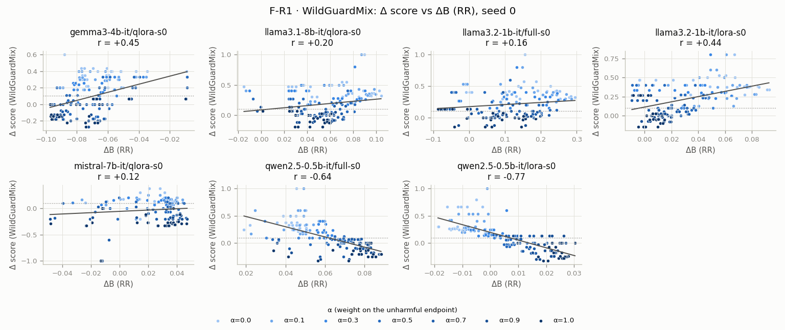
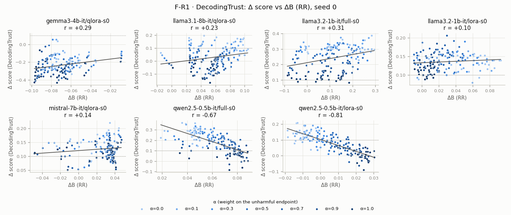
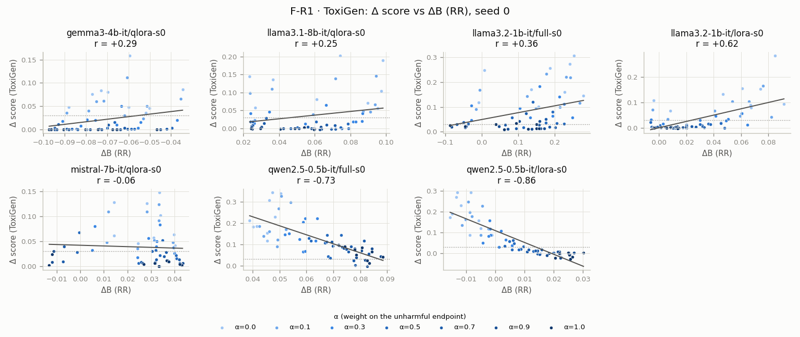
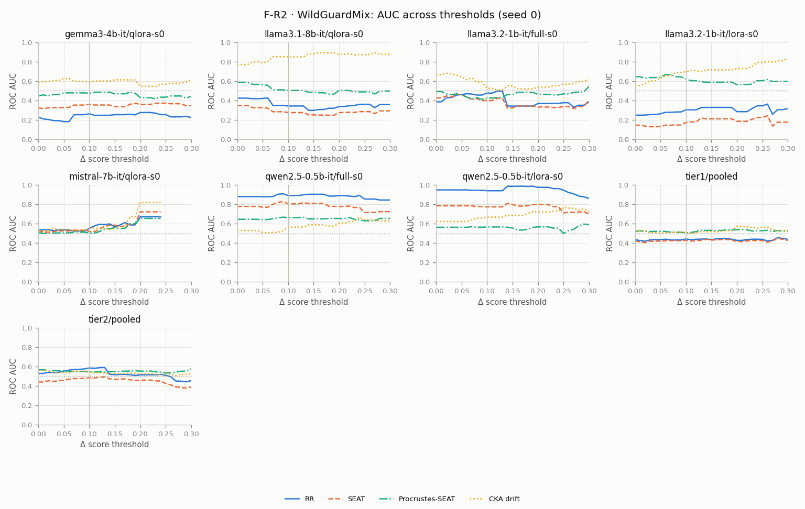
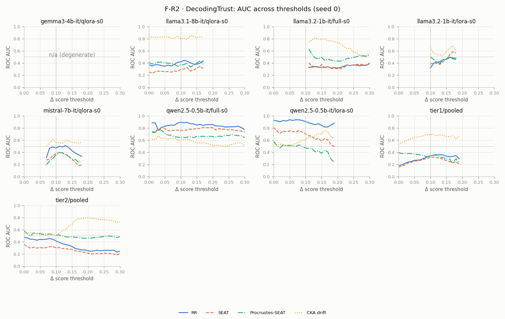
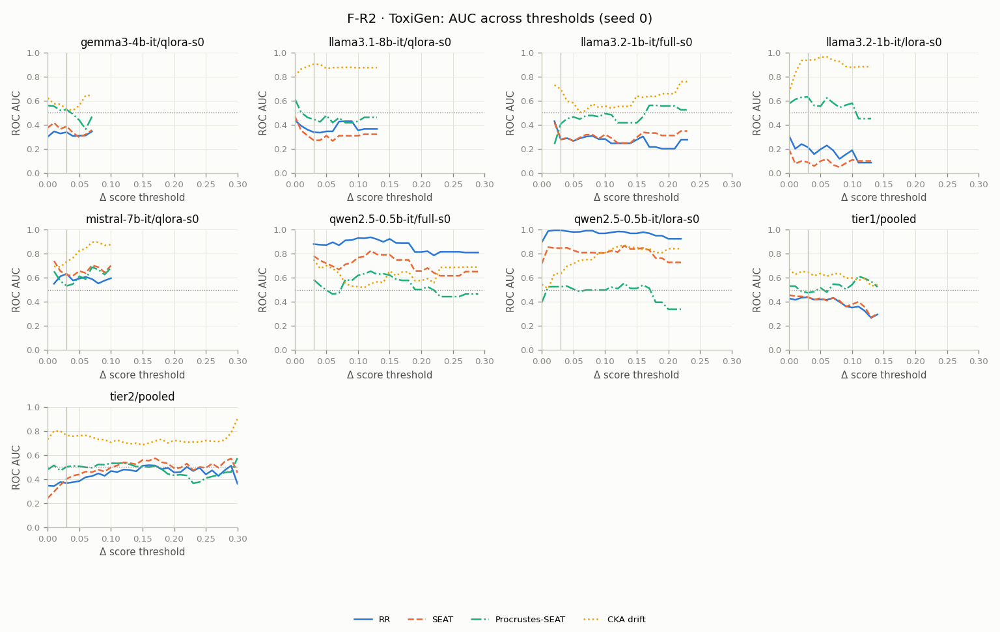
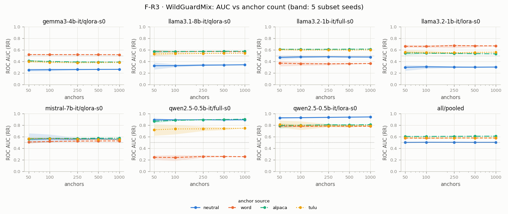
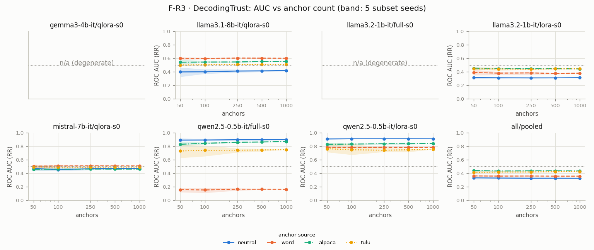
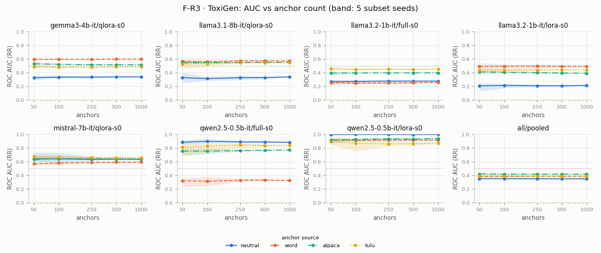
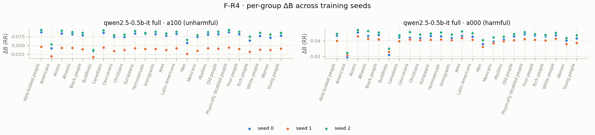
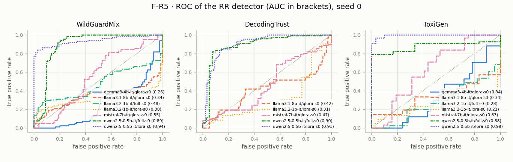

## Deviations from the paper (realised)

Every decision whose paper-deviation field is *yes* (DECISION.md); the planned list is PLAN §1.3.

| Decision | Title | Deviation |
|---|---|---|
| D-001 | Split the study into three tiers | App. C training regimes, T1 full-FT columns. |
| D-002 | Hardware target 2× T4; budget unit = Kaggle session-hours | §4.6 / App. C (A100 40GB, bf16). |
| D-003 | Tier 1 training = QLoRA (NF4), one split per GPU in parallel | App. C (bf16 LoRA). |
| D-004 | One precision and placement per model for embeddings and generation: fp16 un-quantised base + adapter | App. C (bf16). |
| D-005 | Gemma-3 numerics: fp32 for inference; fp16-then-fp32 fallback for training | App. C precision. |
| D-009 | Tier 2 models and full-FT recipe | App. C models. |
| D-010 | Harmful split = existing WildGuardMix harmful examples only | (reconstruction) — App. C datasets. |
| D-011 | Unharmful split definition `[unspecified in paper]` | (reconstruction) — App. C. |
| D-012 | Target groups and target sentences (reconstruction) | (reconstruction) — App. F. |
| D-013 | Positive and negative attribute sets (reconstruction) | (reconstruction) — App. F. |
| D-014 | Neutral in-domain anchors (reconstruction) | (reconstruction) — App. F. |
| D-015 | Anchor ablation sources and sizes (reconstruction) | (reconstruction) — §4.5, F4. |
| D-016 | Attribute and target ablation variants (reconstruction) | (reconstruction) — App. E. |
| D-022 | DecodingTrust stereotype: port the pipeline; n=3 samples per prompt; all 3 system prompts | (reconstruction + subsampling) — App. C. |
| D-025 | ToxiGen: 9-group map, prompt subsample, first-statement rule `[partly unspecified]` | (subsampling + reconstruction) — App. C. |
| D-026 | Subsampling policy and uncertainty reporting | (subsampling) — App. C. |
| D-031 | Version pins (starting point, verified in M0) | Python version (App. C). Library adds. |
| D-033 | Seeds ablation on Tier 2 only | App. E.5. |
| D-034 | Tier 1 regime = LoRA only | T1. |
| D-042 | Budget fallbacks and cut order (supersedes D-035) | when a fallback is taken (App. C max length / epochs). |
| D-052 | Sentence-set construction details (amends D-012–D-016) | (reconstruction) — App. E, App. F. |
| D-062 | Gemma-3-4B fp16 extraction probe failed: embeddings stay fp32 (outcome of D-005 / D-058 criterion) | App. C precision, as already logged in D-005. |
| D-078 | Gemma-3-4B: fp16 training fails at the first forward; fp32 projects 11.66 h for 1 epoch, so the D-070 rule stops and asks the user | (as already logged in D-005), App. C precision: fp32 compute instead of bf16. |
| D-086 | M5 design: pinned benchmark sources, DT reproduced exactly at T = 1.0, one process per checkpoint, paired sampling, scores with paired-bootstrap CIs (implements PLAN M5; amends D-022, D-023, D-025, D-026, D-043) | DT n = 3 instead of 25 (D-022); ToxiGen subsample (D-025); local topic mapper (D-043); WildGuard input without the literal `<s>`. All App. C / App. B reconstructions. |
| D-095 | WGM topic map = the user's labels of all 76 prompts; the Qwen mapper failed validation (50%) and is kept for sensitivity (supersedes D-043; amends D-088) | App. B used an LLM topic mapper; we use a human map over the full subcategory. |
